# Void Legacy Retailers — WEDE5020 POE Part 3

Student: Roan Luke Phiri (ST10504092)

Void Legacy is a fictional Cape Town techwear brand. This five-page website presents five collection concepts, supports catalogue browsing and demonstrates product enquiries and general contact messages. The [dated changelog](CHANGELOG.md) records the changes.

## Project structure and sitemap

| File or folder | Purpose |
| --- | --- |
| `index.html` | Home hero, category previews and calls to action. |
| `about-us.html` | Brand history, mission, vision and design approach. |
| `products.html` | Five concepts, keyword search, category filtering, sorting and gallery lightbox. |
| `enquiry.html` | Validated product, sizing, wholesale and collaboration enquiries with local responses. |
| `contact.html` | Concept contact details, Cape Town map and general-message email draft. |
| `css/styles.css` | Shared reset, colours, typography, layouts, breakpoints and interaction states. |
| `js/main.js` | Catalogue loading, DOM updates, gallery controls and form validation. |
| `data/products.json` | Searchable catalogue records. |
| `_images/` | Existing collection assets and optimised image variants. |
| `docs/screenshots/` | All five pages at mobile, tablet and desktop widths. |
| `docs/TESTING.md` | Verification results and limitations. |
| `scripts/check-browser.cjs` | Repeatable Playwright interaction checks and screenshot capture. |
| `robots.txt`, `sitemap.xml` | Crawl instructions and five-page sitemap template. |
| `CHANGELOG.md` | Dated development changes. |

Shared navigation connects all five pages. The gallery is part of Products rather than a separate sixth page.

## Home collection update — 1 November 2026

Added Utility vest and Urban cap concept cards to the Home collection grid, alongside outerwear, pants and accessories. Both cards use responsive image sources and link to their matching catalogue sections. The cap is explicitly labelled Unreleased and does not display a confirmed release date or stock status the concept is ther to show that the brand is always improving items.

## Vest collection addition — 1 November 2026

Added the Utility vest concept as the fifth catalogue item, using `techwear-vest.webp`. The item is included in keyword search, Vests filtering, alphabetical sorting, the result count and gallery navigation. Its enquiry link preselects the product enquiry type and utility vest message. Products screenshots were refreshed at all three documented viewport widths, and vest search, filtering, gallery display and enquiry preselection passed browser checks. 

## Complete change summary

- **Vest addition:** Added the Utility vest concept, responsive images, Vests category and filter, searchable JSON record, gallery entry and product enquiry preselection.  

- **Shared stylesheet:** Moved `_css-assets/styles.css` to `css/styles.css` and updated all five pages. Corrected the sizing reset to include elements, `::before` and `::after`.

- **Home:** Removed the stray `<` before the hero and retained collection previews and working links.

- **About, Enquiry and Contact:** Added a collection image and caption to each page.

- **Navigation and catalogue links:** Restored the Headwear category link and connected product enquiry buttons to their product-specific enquiry URLs.

- **Image optimisation:** Generated 320px, 640px and 960px jacket/trouser WebP variants. Added `srcset`, `sizes`, mobile `<picture>` sources and a 128px navigation logo.kept the original images .

- **Catalogue data:** Added `data/products.json` and asynchronous loading through `fetch()`, with HTML cards retained as a fallback.

- **Search and filtering:** Added keyword search, category selection, A–Z/Z–A sorting, a result count and an empty-results message.

- **Collection lightbox:** Added a modal gallery with captions, previous/next controls, arrow-key navigation, Escape dismissal and focus restoration.

- **Enquiry form:** Replaced the static preview with JavaScript validation and category-specific responses for wholesale, sizing, products, collaborations and store information.

- **Product preselection:** Used recognised product URL parameters to preselect the enquiry type and populate the message.

- **Contact form:** Added name, email, optional phone, message type and message fields, with an encoded email draft prepared after validation.

- **Validation and accessibility:** Added trimmed required-value and minimum-length checks, email and phone constraints, inline errors, `aria-invalid`, `aria-describedby` and focus on the first invalid field.

- **FAQs and motion:** Added expandable enquiry FAQs and an opening animation

- **Interaction styling:** Added styles for catalogue controls, gallery buttons, the modal, FAQs, validation errors and response panels. Extended visible keyboard focus to new controls.

- **SEO:** Retained page-specific titles, descriptions, headings and alt text. Added `robots.txt` and a five-page `sitemap.xml` template, with the gallery included within Products.

- **Safer dynamic text:** Used `textContent` for dynamic responses and encoded email fields instead of inserting user input as HTML.

- **Responsive verification:** Captured all five pages at 390px, 768px and 1440px widths, producing 15 screenshots. Confirmed no horizontal overflow during these checks.

## Feedback addressed

- **Sitemap:** Updated it to match the five implemented pages and added a working gallery within Products.

- **CSS reset:** Applied `border-box` to all elements and both pseudo-elements.

- **Home page:** Removed the stray `<` before the hero section.

- **Page imagery:** Added a collection figure to About, Contact and Enquiry.

- **Keyboard accessibility:** Added consistent visible focus outlines to gallery buttons and FAQ summaries.

- **Responsive images:** Added 320, 640 and 960-pixel jacket and trouser WebP variants, `srcset`, `sizes` and mobile `<picture>` sources, while retaining existing cap variants.

- **Stylesheet organisation:** Moved the stylesheet into the `css/` folder and updated all links.

- **Changelog and references:** Added dated, file-specific changes, technical references and an asset inventory.

- **Part 1:** Expanded browsing goals, technology choices, content and budget details while retaining semantic landmarks and shared navigation.

## Functionality and responsive design

The browsing goals are to reach each page through the navigation, locate a concept by keyword or category, inspect a larger image and obtain an appropriate enquiry response. Stock, prices, opening hours and the concept store address are not verified business information.

 JavaScript loads local catalogue JSON asynchronously and updates the existing HTML cards. Search covers names and descriptions; category filters and alphabetical sorting refine the results. HTML cards remain available if the request fails. A native `<dialog>` provides the gallery, including previous/next controls, arrow keys, Escape dismissal and focus restoration. Native `
` elements provide expandable FAQs. Contact includes a zoomable general Cape Town map and external map link.

Mobile-first CSS uses two-column layouts from 48rem and wider hero/enquiry layouts from 72rem. Fluid headings use `clamp()`. Navigation wraps, images have intrinsic dimensions, and larger assets use responsive sources. Below-the-hero images use lazy loading. The logo has a smaller navigation derivative and the shared script is deferred. Skip links, form labels, keyboard outlines and reduced-motion support are retained.

Both forms validate required fields, email syntax, trimmed minimum lengths and maximum lengths. Contact also checks the optional phone format. Errors appear beside controls and focus moves to the first invalid field. Enquiry responses explain the details required for sizing, wholesale, product or collaboration requests without claiming a live stock or price check.

## SEO and security

Each page retains a unique title and description, one main heading, descriptive subheadings, alt text, readable filenames and internal links. Keyword themes include Cape Town techwear, utility outerwear, cargo trousers, urban headwear and wholesale streetwear enquiries. The sitemap is a template containing example-domain URLs.

Dynamic text uses `textContent`, and email draft fields are encoded.

## Technology and cost scope

HTML provides semantic content, CSS Grid/Flexbox provides layout, and JavaScript provides interactions without a framework dependency. 

## Responsive evidence

Each page was captured at 390px, 768px and 1440px browser widths. Full-size PNGs are stored in `docs/screenshots/`.

### mobile evidence

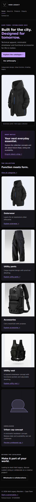

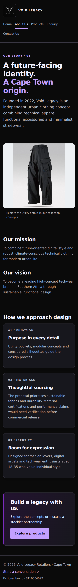

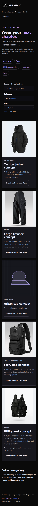

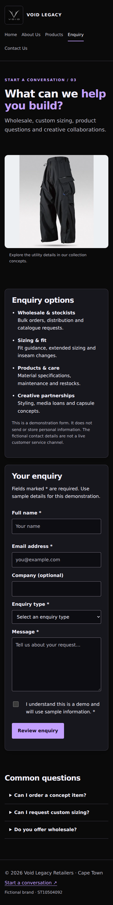

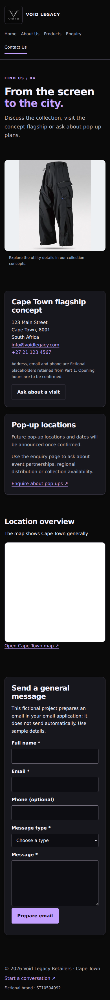
### tablet evidence

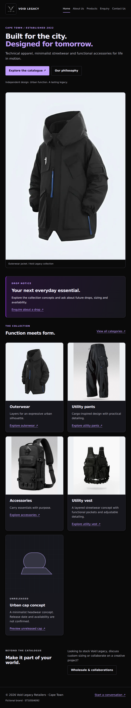

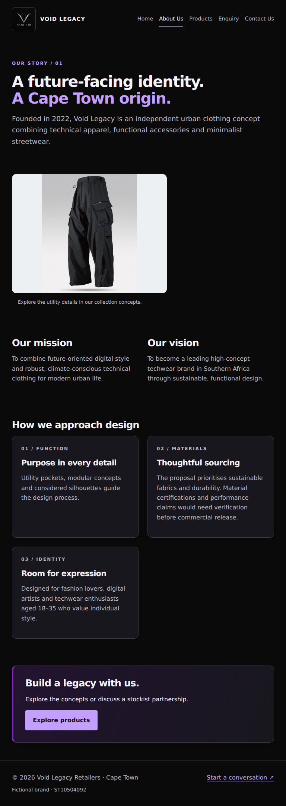

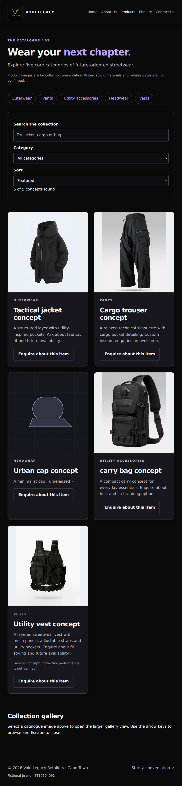

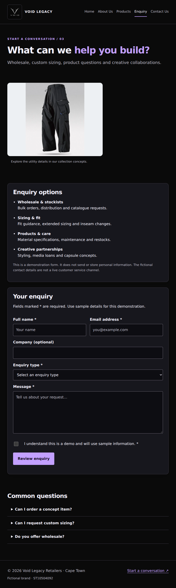

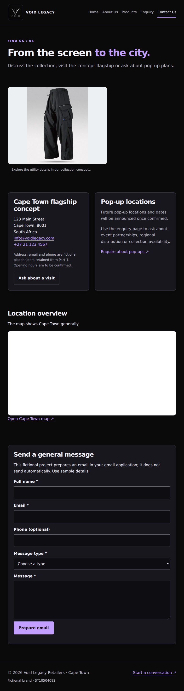
### desktop evidence

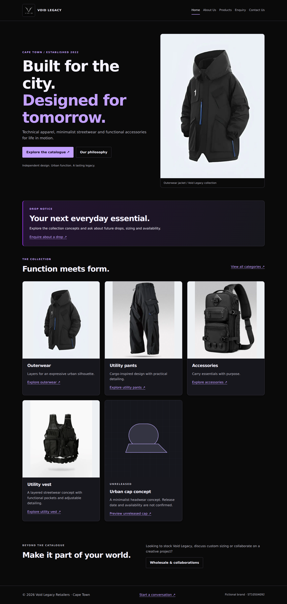

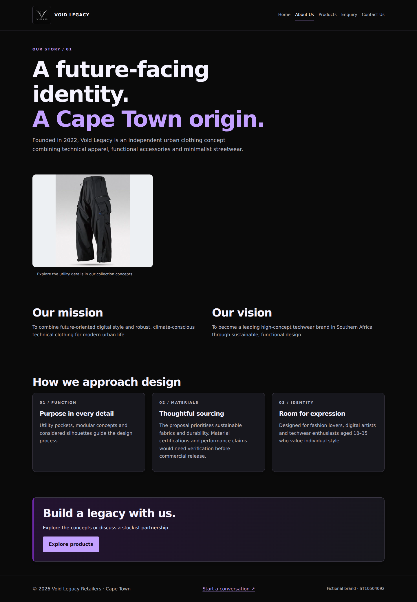

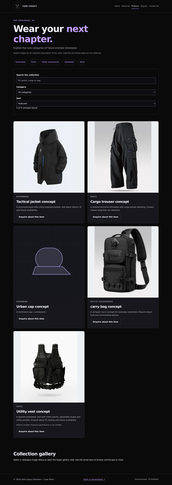

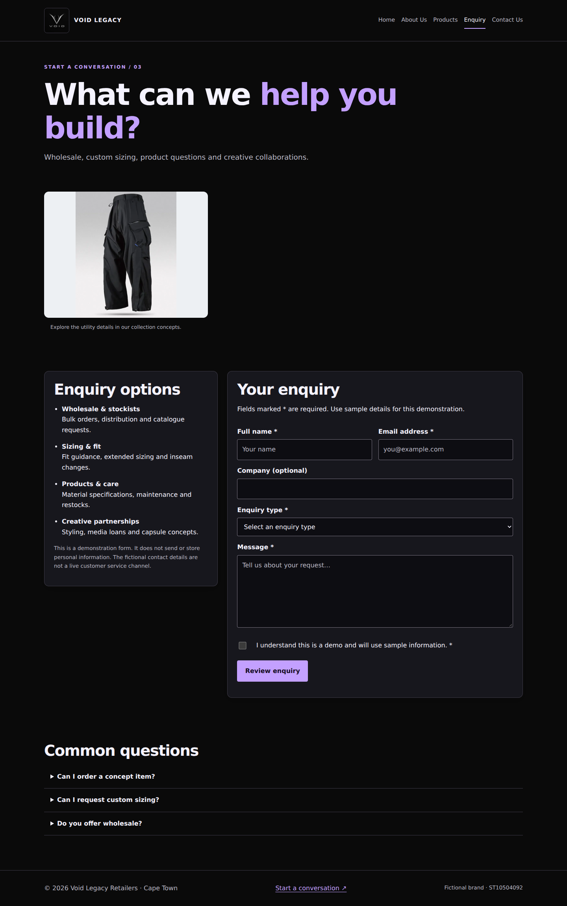

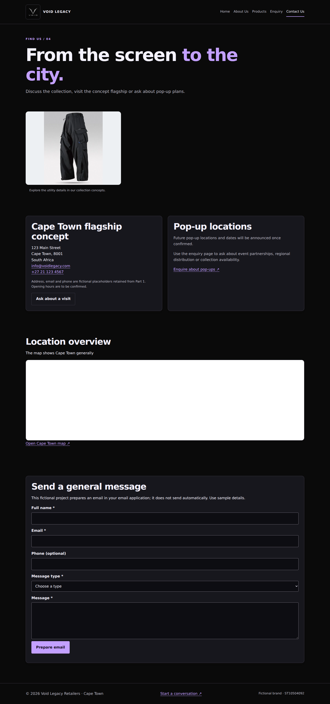

## Asset provenance and references

The images are retained from the Part 2 project. 

- **`outerwear-jacket.webp`:** Existing 1154 × 1600 jacket image with smaller WebP derivatives added.
- **`utility-pants.webp`:** Existing 1000 × 1251 trouser image with smaller WebP derivatives added.
- **`utility-accessories.webp`:** Existing 256 × 320 bag image retained without artificial higher-resolution variants.
- **`headwear-320.webp`, `headwear-640.webp`, `headwear-960.webp`:** Existing cap concept artwork and responsive variants retained.
- **`void-legacy-logo.png`, `logo-128.webp`:** Existing logo and smaller navigation derivative retained.
- **`techwear-vest.webp`, `techwear-vest-320.webp`, `techwear-vest-640.webp`:** Uploaded 800 × 1000 vest photograph with generated responsive derivatives. External creator and licence remain unverified.
- **`wordmark.svg`:** Earlier wordmark retained as an asset.

Technical references:

web.dev (n.d.) Responsive images. Available at: https://web.dev/learn/design/responsive-images (Accessed: 9 November 2026). Covers responsive image selection and sizing. web.dev

World Wide Web Consortium (W3C) (n.d.) Validating input. Available at: https://www.w3.org/WAI/tutorials/forms/validation/ (Accessed: 9 November 2026). Covers form validation and accessible error handling. W3C

World Wide Web Consortium (W3C) (n.d.) Dialog (modal) pattern. Available at: https://www.w3.org/WAI/ARIA/apg/patterns/dialog-modal/ (Accessed: 9 November 2026). Covers keyboard interaction and focus management for modal galleries. W3C

Microsoft Bing (n.d.) How to create a robots.txt file. Available at: https://www.bing.com/webmasters/help/how-to-create-a-robots-txt-file-cb7c31ec (Accessed: 9 November 2026). Covers crawler instructions and sitemap references. Bing Webmaster Tools

Microsoft Bing (n.d.) Sitemaps. Available at: https://www2.bing.com/webmasters/help/sitemaps-3b5cf6ed (Accessed: 9 November 2026). Covers sitemap formats and search-engine discovery.